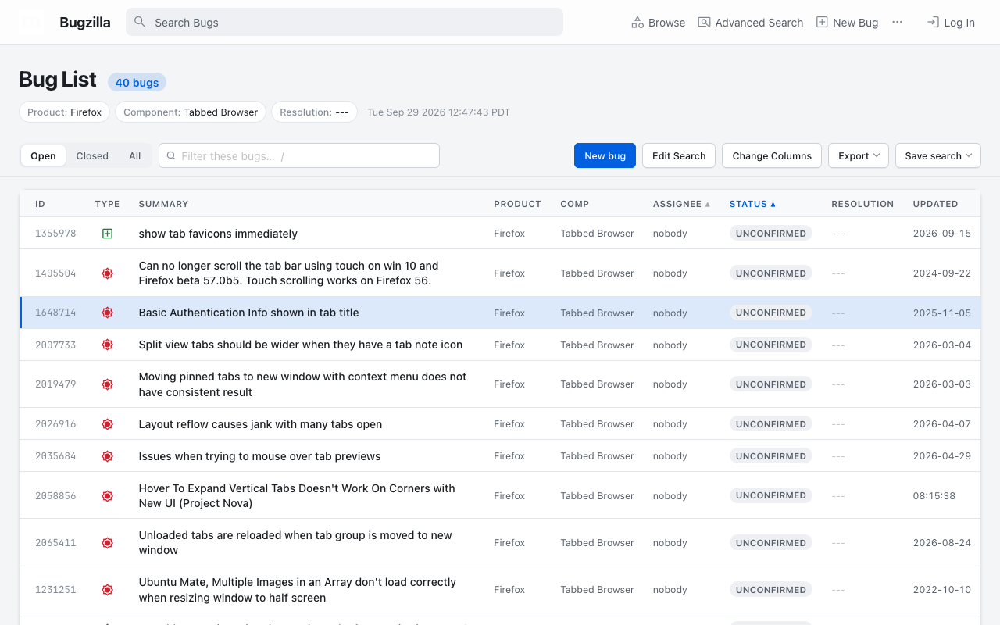

# Pretty Bugz

A Firefox extension that gives [bugzilla.mozilla.org](https://bugzilla.mozilla.org) a clean, modern look and rebuilds its busiest pages around how people actually use them.



## Features

**Theme** (every page)

- System fonts, softer colours, rounded cards, clear focus rings and tidy form controls
- Light, dark or automatic appearance
- Readable comments, status pills and a frosted header on bug pages

**Layouts** (can be turned off separately)

| Page | What changes |
| --- | --- |
| `enter_bug.cgi` | A step-by-step wizard: Summary → Category → Description → Attachments & security → Optional details → Review |
| `enter_bug.cgi` product chooser, `describecomponents.cgi` | Big search box, a grid of product cards you can click anywhere on |
| `buglist.cgi` | Result count and search chips, sticky toolbar, instant row filter, Export/Save menus, `j`/`k`/`o`/`/` shortcuts |
| `query.cgi?format=advanced` | Grouped cards, filter boxes for long lists, "N active" badges, sticky search bar |
| `query.cgi?format=specific` / `instant` | A search-engine style hero |
| `request.cgi` | Collapsible filters, one card per group, relative ages, filter box and group jump |
| `describecomponents.cgi?product=…` | Product header with quick actions, filterable component cards, A–Z jump |
| `show_activity.cgi` | A day-grouped timeline with field chips, person filter and "hide CC changes" |
| `describekeywords.cgi` | Filterable, sortable keyword cards |
| `user_profile` | Profile header, stats tiles, activity-by-product bars |
| `page.cgi?id=attention.html` | A triage dashboard: counts per list, priority tiers, collapsed empty lists |
| `page.cgi` help pages | Readable articles with a sticky table of contents |
| `page.cgi?id=custom_forms.html` | A card grid of custom bug forms |
| Other `page.cgi` reports | A page title and the form in a panel |

Everything is controlled from the toolbar popup: turn the theme on or off, turn the layouts on or off, and pick Auto / Light / Dark. Changes apply immediately, without reloading.

## Privacy

Pretty Bugz only runs on `https://bugzilla.mozilla.org/*`. It collects no data, makes no network requests of its own and only stores your three popup settings in Firefox's local extension storage.

## Install

- **From addons.mozilla.org:** search for "Pretty Bugz" once it's published.
- **From source (temporary):** open `about:debugging#/runtime/this-firefox`, choose **Load Temporary Add-on…** and pick `manifest.json`.

Requires Firefox 142 or later.

## Development

There is no build step: the files in `content/`, `popup/` and `icons/` are what ships.

```sh
npm install          # installs web-ext
npm start            # launches Firefox with the extension loaded
npm run check        # manifest/file consistency and syntax checks
npm run lint         # web-ext lint
npm run fixtures     # downloads real BMO pages into test/fixtures (needs network + Chrome)
npm test             # applies and reverts every layout on every fixture
npm run screenshots  # regenerates store/screenshots
npm run build        # packages web-ext-artifacts/pretty_bugz-<version>.zip
```

The offline harness (`tools/harness.mjs`) injects the extension into saved pages and screenshots them with headless Firefox. `npm test` uses headless Chrome. By default it looks for both browsers in `/Applications`; set `FIREFOX` and `CHROME` to use other paths.

See [AGENTS.md](AGENTS.md) for architecture and conventions.

## Project layout

```
manifest.json            MV3 manifest (content scripts run at document_start)
content/theme.css        the global theme: overrides BMO's CSS custom properties
content/layouts.css      shared layout building blocks (cards, action bar, tabs, …)
content/lib.js           PrettyBugz.h / Changes / register helpers
content/layouts/*.js|css one pair per redesigned page
content/content.js       reads settings, toggles the theme, applies/reverts layouts
popup/                   toolbar popup
tools/                   test harness, checks, screenshot extras, the enter_bug mock
store/                   addons.mozilla.org listing text, icon and screenshots
```

## License

[Mozilla Public License 2.0](LICENSE). Pretty Bugz is an independent project and is not affiliated with Mozilla.
